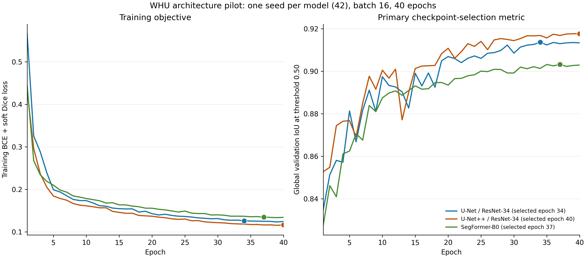
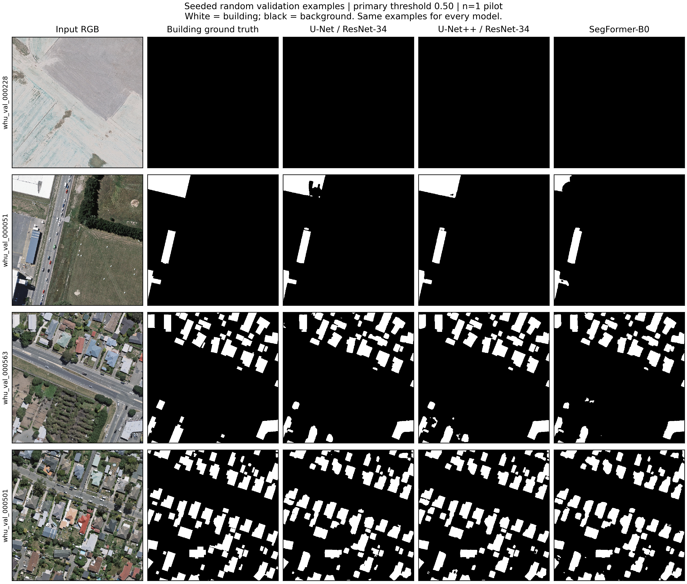

# Controlled WHU architecture comparison

Completed November 15, 2026: **three models × 40 epochs**, using seed 42 and
common batch size **16** on an RTX 3090. Every architecture started fresh from
its registered ImageNet encoder weights, with the same data, loss, optimizer,
augmentation and validation-best checkpoint policy.

The original November 14 batch-4 registration and timing evidence remain intact;
the batch-16 amendment uses a separate registered plan and output directory.

The completed 40-epoch batch-4 U-Net is retained as a supplemental baseline,
including its validation-best checkpoint (epoch 34). It is excluded from the
three-model batch-16 comparison. All three new runs and their independent
validation checks have finished.

## Completed results

Primary endpoint: global building IoU on all **1,036 validation tiles** at
threshold **0.50**, using each architecture's validation-best checkpoint.

| Model | Selected epoch | Validation IoU @ 0.50 | Delta vs U-Net (IoU percentage points) |
| --- | ---: | ---: | ---: |
| U-Net / ResNet-34 | 34 | 0.913608 | 0.000 |
| U-Net++ / ResNet-34 | 40 | **0.917648** | +0.404 |
| SegFormer-B0 | 37 | 0.903176 | −1.043 |

U-Net++ had the highest validation point estimate under this common recipe.
There is one seed per model, so these results do not establish seed-level
significance or an architecture's best achievable performance. U-Net and
U-Net++ share identical starting encoder tensors; SegFormer also changes the
encoder family and capacity. No new test inference was performed.

Validation-only threshold calibration selected 0.50 for all three models, so
the secondary calibrated scores equal their primary scores.



[SVG curves](figures/whu_architecture_batch16_2026-11-15/learning_curves.svg) ·
[Full-precision summary and source hashes](figures/whu_architecture_batch16_2026-11-15/summary.json) ·
[Generated comparison report](figures/whu_architecture_batch16_2026-11-15/report.md).

### Qualitative validation inference

Four validation IDs were sampled with seed 42 and frozen before checkpoint
loading or prediction. The same images and threshold 0.50 are used for every
model; examples were not selected by model performance. The blank first tile is
retained as sampled rather than replaced with a more visually appealing example.



These illustrations use CPU float32 inference from the verified selected
checkpoints. Four of twelve per-image confusion-count comparisons exactly
matched the server's batched CUDA evaluation; the others differed by at most
five in any confusion-count cell. The largest absolute per-image IoU difference
was 0.000107. Quantitative results above use the independently reassessed server
evaluation, not these illustration subsets.

[Frozen example selection](figures/whu_architecture_batch16_2026-11-15/selection.json) ·
[Prediction/count metadata](figures/whu_architecture_batch16_2026-11-15/qualitative_metadata.json) ·
[SVG examples](figures/whu_architecture_batch16_2026-11-15/qualitative_validation.svg).

### Completion and artifact verification

The final archive contained **95 verified files** with 632,565,397 payload bytes,
including all three `best.pt` and `final.pt` checkpoints, complete histories,
frozen source, per-image validation records, and the supplemental batch-4
baseline. The archive SHA256 is:

`bd01bccaa9cf4c4ea7f8e70fc6660d481c4a4e2b4a5062c6e17eba10cb823ad4`.

The downloader checked the archive hash and every registered member before
acknowledging retrieval. Both temporary Runpod pods were then confirmed absent.
Large checkpoints, raw images and private connection credentials remain outside
Git. Portable summaries and figures are included here.

To reproduce the post-training analysis from a verified extracted result root:

```powershell
python scripts/analyze_architecture_comparison.py --results <result-root> --out <figure-directory>
python scripts/qualitative_architecture_comparison.py --results <result-root> --data data/whu_official_prepared --out <figure-directory> --examples 4 --seed 42
```

## Models and common controls

| CLI architecture | Segmentation model | Encoder initialization | Parameters |
| --- | --- | --- | ---: |
| `unet-resnet34` | U-Net | ImageNet ResNet-34 | 24,436,369 |
| `unetplusplus-resnet34` | U-Net++ | Identical ImageNet ResNet-34 tensors | 26,078,609 |
| `segformer-b0` | SegFormer | ImageNet MiT-B0 | 3,714,401 |

All three use segmentation-models-pytorch 0.5.0, a fresh binary segmentation
decoder, and full-resolution one-channel logits. Full models are trained end to
end. No previously fine-tuned WHU checkpoint initializes any arm. The two
ResNet-34 encoder states have the same recorded tensor fingerprint; every run
checks its expected encoder identity before constructing the optimizer.

U-Net versus U-Net++ controls the encoder while changing the decoder. SegFormer
compares a different complete architecture and parameter budget; its result
cannot isolate attention alone from encoder capacity and pretrained features.

The shared recipe is:

- Official WHU partitions: **4,736 train / 1,036 validation / 2,416 test**.
  Original imagery, masks and geographic assignments remain unchanged.
- Native **512 × 512 RGB**, ImageNet mean/std normalization, batch **16**, four
  data workers, seed **42** for every architecture.
- Uniform shuffled sampling **without replacement**: all 4,736 training tiles
  are seen once per epoch. No hard-example weights or label overlays.
- Standard synchronized flips and 90° rotations, plus the existing moderate
  brightness/contrast augmentation. Validation receives no augmentation.
- BCE with logits plus soft Dice, positive weight 1; no auxiliary boundary head.
- AdamW, learning rate **0.0003**, weight decay **0.0001**, cosine decay to
  0.02 times the starting rate, CUDA AMP, gradient clipping at 1.0.
- **40 complete epochs per model**, patience 41. At batch 16 this is **296
  optimizer batches per epoch and 11,840 steps per full run**. Every training
  tile is still seen once per epoch. The original batch-4 recipe used 1,184
  batches per epoch and 47,360 steps per run.

The batch amendment changes gradient averaging and BatchNorm behavior. Learning
rate, loss, augmentation, encoder initialization, geographic partitions and
checkpoint selection remain unchanged. No model switches batch size partway
through fitting, and batch-4 results are not pooled with batch-16 results.

A subsequently cancelled batch-32 timing probe overlapped with the active
batch-16 training process. Those batch-32 timings are invalid for throughput
comparison and are excluded. Operational training wall times include that
initial contention; isolated batch-16 probes provide the throughput estimate.

Dataset content SHA256:
`538ac8569dcfd817b8557bc23ed18977de5dbba8d4b19719c82ab5ee4d1a308d`.

## Validation-best checkpoint policy

The primary endpoint uses the checkpoint with the highest **global validation
building IoU at threshold 0.50** across all 40 epochs. `min_delta=0` preserves the
strict maximum; exact ties keep the earliest epoch. The trainer's `final.pt` is
retained for diagnostics but is not substituted into the architecture comparison.

After fitting, the selected `best.pt` is independently reloaded and evaluated
on every validation tile. Saved epoch, history maximum, configuration, encoder
initialization hash, dataset identity, per-image counts and aggregate scores are
checked. Validation-only calibration over 0.15–0.85 in steps of 0.05 is reported
as a **secondary** result using that same selected checkpoint.

The runner performs no test inference. The existing WHU test has already
informed development, and one seed does not estimate training variability or
independent geographic generalization. This is an architecture pilot under a
common recipe, not a claim that each architecture has been individually tuned
to its best attainable score.

## Batch-16 Runpod runtime estimate

The isolated RTX 3090 (24 GB) probe used batch 16 for every model, PyTorch
2.5.1+cu121, segmentation-models-pytorch 0.5.0, CUDA AMP training and full-precision
validation. It retained no trained weights or accuracy results.

| Model | Train batch median (s) | Validation batch median (s) | Estimated 40-epoch run (hours) | Probe peak allocated (GiB) |
| --- | ---: | ---: | ---: | ---: |
| U-Net / ResNet-34 | 0.149 | 0.067 | 0.70–1.22 | 3.85 |
| U-Net++ / ResNet-34 | 0.330 | 0.170 | 1.47–2.37 | 8.53 |
| SegFormer-B0 | 0.542 | 0.100 | 2.22–3.50 | 5.72 |

**Planning total: 4.4–7.1 hours for three fresh 40-epoch runs.** These are
heuristic allowances from a short probe, not confidence bounds or a guarantee.
The [portable batch-16 evidence](benchmarks/WHU_ARCHITECTURE_BATCH16_RUNPOD_PROFILE_2026-11-15.json)
contains the measured observations, image IDs, initialization/source identities,
memory measurements and projection method. Initial orchestration contention is
recorded separately and is not used to make batch-32 speed claims.

## Original batch-4 laptop runtime estimate

Measured on the RTX 4060 Laptop GPU (8 GB), Python 3.10.11, PyTorch 2.5.1+cu121,
and segmentation-models-pytorch 0.5.0. All three models fit the common batch size.

| Model | Train batch median (s) | Validation batch median (s) | Estimated 40-epoch run (hours) | Probe peak allocated (GiB) |
| --- | ---: | ---: | ---: | ---: |
| U-Net / ResNet-34 | 0.103 | 0.039 | 1.76–2.95 | 1.21 |
| U-Net++ / ResNet-34 | 0.251 | 0.103 | 4.22–6.63 | 2.39 |
| SegFormer-B0 | 0.456 | 0.074 | 7.23–11.17 | 1.52 |

**Total for the selected three-run pilot: 13.2–20.8 hours.**

SegFormer-B0 trained more slowly in this measured configuration despite having
fewer parameters. Parameter count alone should not be used to estimate runtime.
The [portable timing and plan evidence](benchmarks/WHU_ARCHITECTURE_PROFILE_2026-11-14.json)
retains every measured batch duration, selected sample IDs, initialization hashes,
memory observations, source identities and the projection method.

The probe uses actual training/validation tiles, the same 512px/batch-4 loading
and augmentation, four warmup batches per phase, 32 measured optimization
batches, and 12 measured validation batches per model. Temporary optimization
weights are discarded; no trained checkpoint is saved. Validation timing uses
full-precision inference and confusion counts, matching the existing trainer.
An additional model copy exercises the original-plus-selected-model GPU residency
used during checkpoint reload/calibration.

Per-epoch planning time is `1,184 × training batch time + 259 × validation batch
time`. The lower planning bound uses median batch times ×1.15; the upper uses
the slower median/p90 projection ×1.75. Each run additionally reserves 5–15
minutes for audits, hashing, startup, checkpoint writing, calibration, and
selected-checkpoint reassessment. These are explicit heuristic allowances,
**not statistical confidence bounds**.

A short probe cannot establish sustained laptop throughput. In the previous
20-epoch U-Net study, elapsed runs ranged from 50.8 to 265.7 minutes despite
the same architecture and epoch budget. Power, temperature and competing work
can make full runs exceed a short-probe estimate. Peak allocated memory in the table
is PyTorch's allocation statistic, not total system/GPU usage or a full-run peak.

## Original batch-4 commands and execution safeguards

These commands reproduce the original batch-4 registration. The revised Runpod
study uses a separate job root, a fresh output directory and `--batch-size 16`;
it reuses the verified WHU data and installed environment. It repeats the same
plan-bound GPU memory/runtime probe and cost gate before fitting.

Use the existing GPU environment from the repository root:

```powershell
$env:OMP_NUM_THREADS = '4'
$env:MKL_NUM_THREADS = '4'
$env:CUBLAS_WORKSPACE_CONFIG = ':4096:8'

# Print all three commands without reading data, downloading weights, or fitting.
.\.venv-gpu\Scripts\python.exe -m roof_pipeline.architecture_comparison --data data/whu_official_prepared --out runs/whu_architecture_comparison_2026-11-14 --dry-run

# Prepare once in a fresh output directory; freezes data, source, encoders and settings.
.\.venv-gpu\Scripts\python.exe -m roof_pipeline.architecture_comparison --data data/whu_official_prepared --out runs/whu_architecture_comparison_2026-11-14 --seeds 42 --epochs 40 --batch-size 4 --workers 4 --device cuda

# Profile the prepared plan; no full training or retained trained weights.
.\.venv-gpu\Scripts\python.exe -m roof_pipeline.profile_architectures --plan runs/whu_architecture_comparison_2026-11-14/plan.json
```

The current directory is already prepared and profiled; those two steps refuse
to overwrite existing artifacts. Its `plan.json`, `source_snapshot.zip`,
`runtime_estimate.json` and `status.json` are local Git-ignored records.

Full training is an explicit separate invocation **after reviewing the estimate**:

```powershell
.\.venv-gpu\Scripts\python.exe -u -m roof_pipeline.architecture_comparison --out runs/whu_architecture_comparison_2026-11-14 --execute
```

Execution requires an estimate bound to the exact plan hash and all three
architectures. It checks the GPU name/capacity, runtime libraries, registered
source, encoder identities and frozen WHU content. Both training and final
validation assessment execute from the saved source snapshot, so unrelated new
modules do not invalidate the running study. Existing or partial runs cannot be
silently overwritten or resumed. If a model cannot fit, prepare a new plan with
a smaller **common** batch size for all models and repeat the timing probe.

Per-run histories, `best.pt`, `final.pt`, `validation_best.json`, per-image
validation CSVs and logs are preserved. `comparison.json` and `report.md` are
written only after all three runs complete and verify. A three-seed extension
requires a separate fresh plan, for example `--seeds 42,1337,2026`; it would
contain nine runs rather than the selected three-run pilot. At the measured rates,
that extension is approximately 39.6–62.3 hours and requires its own plan-bound
estimate before execution.

## Original setup verification

Local verification passed 286 tests, including 13 additional unittest subtests,
and Ruff lint. Checks cover real CPU forward/strict checkpoint round trips for
both new architectures, matching preprocessing, encoder identity enforcement,
strict validation-best selection with earliest ties, frozen assessment, and
refusal to execute without a matching runtime estimate. Full scientific training
and remote CI remained unperformed at setup time.

## Completion verification

All 120 training epochs completed on the RTX 3090. The frozen evaluator checked
each selected checkpoint against the history maximum, configuration, encoder
identity, dataset hashes and all 1,036 validation examples. All 95 archived files
passed the downloader's outer and per-member hash checks before cleanup.

Post-training JSON analysis and the twelve CPU validation predictions completed.
The latter checked the local dataset and checkpoint hashes before loading the
models, and retained the small CPU/CUDA count differences in their metadata.
Core experiment and analysis tests use the GPU Python environment; API tests use
the separate supported Python 3.12 serving environment. The training environment
uses Python 3.10 and is not the supported API-serving profile.

Final local gates passed: **316 core tests**, **18 ablation tests plus 13
subtests**, and **41 API tests** in the supported serving environment. Ruff lint
passed. The full GPU-environment pytest invocation also exercised the API tests;
its two failures were the existing Python-3.12 serving-profile requirement and
Python-3.10 timeout-exception behavior. Both tests passed in the intended serving
environment, without changing serving code or weakening its runtime checks.
