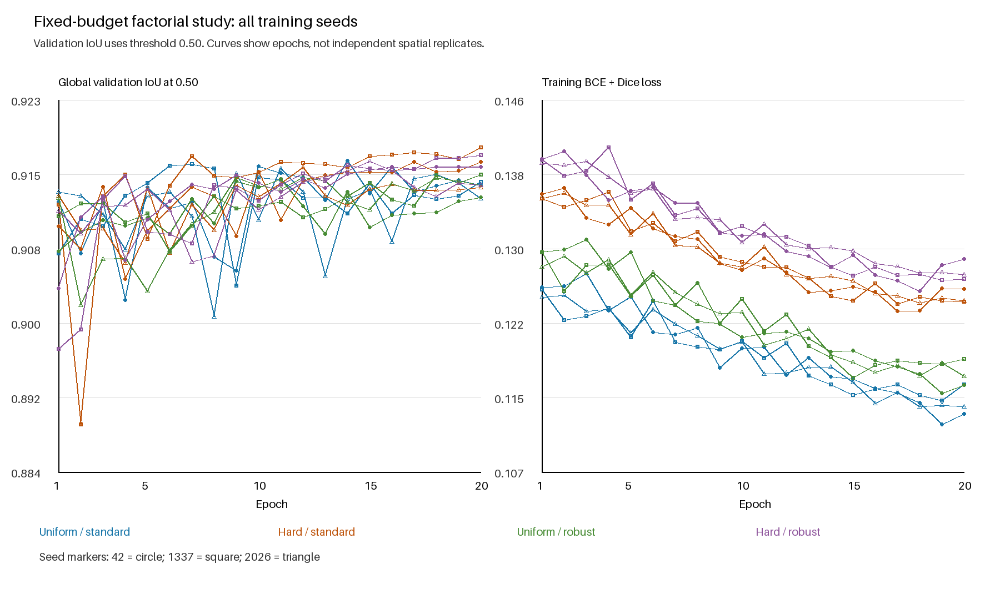
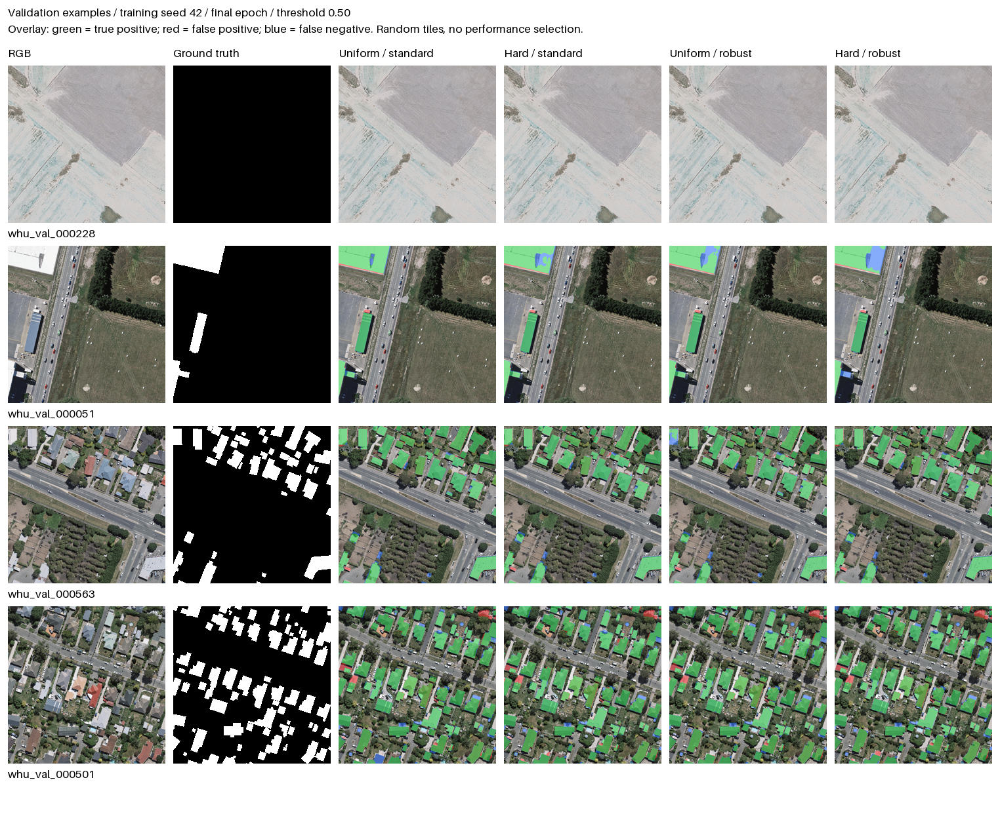

# WHU factorial training ablation — completed results

**Completed November 1, 2026:** all 12 runs finished their full 20-epoch budgets,
and every final checkpoint was evaluated on all 1,036 validation tiles at the
fixed threshold 0.50. This report uses the final trained endpoint, including
runs where validation selection retained a different `best.pt` checkpoint.

Hard-example sampling had a positive estimated main effect of **0.207 IoU
percentage points** across the three matched seeds. Stronger photometric
augmentation had an average effect near zero, with effects changing sign across
seeds. These are exploratory results in the existing WHU geography.

## Question and controls

The earlier refinement changed sampling and augmentation together. This 2×2
factorial study separates their contributions and their interaction. Both uniform
and hard-example arms sample with replacement for 4,736 draws per epoch; actual
unique-image coverage is recorded in the [epoch history](results/whu_factorial_2026-10-31/epoch_history.csv).

- Original publisher partitions and masks: 4,736 training, 1,036 validation,
  2,416 test. No provisional correction overlays or auxiliary boundary head.
- U-Net/ResNet-34, 512 pixels, batch size 4, 20 full epochs per run.
- Seeds 42, 1337, 2026, paired across all four arms: 12 runs, 240 epochs total.
- Every run starts from the original epoch-32 baseline checkpoint,
  `runs/whu_r34_official_2026-10-28/best.pt`.
- AdamW restarts at learning rate 0.0001, weight decay 0.0001, with cosine decay,
  BCE plus Dice, positive weight 1, and CUDA AMP.
- Both augmentation profiles retain synchronized flips and 90° rotations.
  Standard brightness/contrast factors are 0.85–1.15. Robust augmentation uses
  brightness 0.70–1.30, contrast 0.75–1.25, and gamma 0.70–1.40.
- Four Windows data workers and four CPU threads, on the local RTX 4060.
- The primary endpoint is `final.pt`, epoch 20, threshold 0.50. Validation-selected
  and calibrated `best.pt` is retained as a secondary artifact.

The [original protocol](../ablation_study/STUDY_PROTOCOL.md) remains the record of
the validation-only design. [Reproduction instructions](../ablation_study/README.md)
describe the runner and all factor settings.

## Validation results

IoU is global pixel intersection over union, computed from summed confusion
counts over the entire validation partition. Each table entry below is one
completed run, not an average of tile IoUs.

| Training seed | Uniform / standard | Hard / standard | Uniform / robust | Hard / robust |
| --- | ---: | ---: | ---: | ---: |
| 42 | 0.914208 | 0.916629 | 0.912905 | 0.916129 |
| 1337 | 0.914540 | 0.918159 | 0.915321 | 0.917349 |
| 2026 | 0.912787 | 0.913956 | 0.914204 | 0.914182 |

| Treatment | Mean validation IoU (%) | SD across seeds (percentage points) |
| --- | ---: | ---: |
| Uniform / standard — matched control | 91.384 | 0.093 |
| Hard / standard — sampling only | **91.625** | 0.213 |
| Uniform / robust — augmentation only | 91.414 | 0.121 |
| Hard / robust — combined | 91.589 | 0.160 |

The sampling-only arm exceeds its matched control by 0.240 percentage points on
average. Relative to the unchanged starting model's validation IoU of 0.916026,
its mean advantage is only **0.022 percentage points**. The positive sampling
contrast should not be presented as a large improvement over the incumbent
baseline: part of the contrast reflects the uniform control's fine-tuning
degradation. The original baseline remains a meaningful reference.

### Paired factorial effects

Effects are computed within each matched seed, then averaged. The sampling main
effect averages the hard-minus-uniform difference across both augmentation
conditions; the augmentation main effect averages robust-minus-standard across
both sampling conditions. Interaction is the difference of those differences.

| Contrast | Seed 42 | Seed 1337 | Seed 2026 | Mean | SD across seeds |
| --- | ---: | ---: | ---: | ---: | ---: |
| Sampling | +0.282 | +0.282 | +0.057 | **+0.207** | 0.130 |
| Augmentation | −0.090 | −0.001 | +0.082 | **−0.003** | 0.086 |
| Interaction | +0.080 | −0.159 | −0.119 | **−0.066** | 0.128 |
| Combined minus control | +0.192 | +0.281 | +0.140 | **+0.204** | 0.071 |

All entries in this table are **IoU percentage points**. Sampling's estimated
effect is positive for all three seeds, but its magnitude varies. Augmentation
does not show a consistent directional benefit. The interaction is small and
changes sign; this experiment does not establish a reliable interaction.

The machine-readable [run table](results/whu_factorial_2026-10-31/validation_runs.csv),
[arm summary](results/whu_factorial_2026-10-31/validation_arms_summary.csv),
[paired contrasts](results/whu_factorial_2026-10-31/validation_contrasts_by_seed.csv),
and [contrast summary](results/whu_factorial_2026-10-31/validation_contrasts_summary.csv)
retain full precision. CSV IoUs, effects, and SDs use fractions rather than
percentage points.

## Learning curves and matched predictions

Every arm and seed is shown for all 20 epochs. Colors identify treatments;
circle, square, and triangle markers identify seeds 42, 1337, and 2026. Lower
training loss across different sampling/augmentation conditions is not itself
evidence of better validation segmentation.

The same four validation tiles are shown for each seed-42 final checkpoint at
threshold 0.50. Green marks true positives, red false positives, and blue false
negatives. Tile IDs were sampled with a fixed random seed and saved before
qualitative inference: `whu_val_000228`, `whu_val_000051`, `whu_val_000563`, and
`whu_val_000501`. The first tile has no labeled buildings and remains in the
comparison. Examples were not selected by their scores, and four tiles do not
measure the frequency of failure modes across the dataset.

Imagery and raster labels are from the [WHU aerial building dataset](https://gpcv.whu.edu.cn/data/building_dataset.html).
Source imagery and labels retain their original rights; the repository's code
license does not relicense those source materials.
The [selection record](results/whu_factorial_2026-10-31/qualitative_selection.json)
and [checkpoint hashes](results/whu_factorial_2026-10-31/qualitative_checkpoints.json)
bind the displayed examples to the study.

## Runtime and execution provenance

Fitting plus per-epoch validation took **20.60 hours** in total; the full runner
spanned **21.45 hours**, including audits, mining, calibration, final validation,
and figures. Individual run timings ranged from 50.8 to 265.7 minutes. These
elapsed times reflect variable execution conditions and do not establish an
efficiency advantage for any treatment. Energy, dedicated GPU time, and peak
VRAM were not instrumented. The original approximately 11-hour estimate
underestimated the observed elapsed runtime.

After run 11 finished training, unrelated serving-module additions triggered the
runner's directory-wide source guard. All originally registered source files
were verified unchanged. The outstanding validation and final run were completed
using the exact saved source snapshot, with the original weights, data, factors,
and budgets. No partial training was resumed or substituted. This continuation
is recorded in the [portable provenance](results/whu_factorial_2026-10-31/provenance.json).

Dataset content SHA256:
`538ac8569dcfd817b8557bc23ed18977de5dbba8d4b19719c82ab5ee4d1a308d`.

Starting checkpoint SHA256:
`2c5757995dafaa206abac4e22e384cdef78b4d93ab9026975050307ac2d9c7c5`.

The [evidence packet](results/whu_factorial_2026-10-31/README.md) contains the 12
aggregate confusion matrices, all 240 epoch records, settings and artifact
identities, and figure checksums. Large weights, full datasets, and original
per-image files remain in Git-ignored `runs/whu_factorial_2026-10-31/` artifacts.
The original registration precedes the integration commit and records a dirty
source snapshot; its base Git commit alone does not identify the training code.

## Supplemental test inference

The registered study above is validation-only. On November 2, 2026, a separate
follow-up froze and evaluated **all 12 final checkpoints once** on the 2,416
existing WHU test tiles at threshold 0.50, reporting every arm and seed. No
checkpoint, threshold, arm, training setting, or deployment selection was
changed from those scores. This avoided selecting a favorable seed for reporting.

The original WHU test had already informed earlier development. This follow-up is
a descriptive benchmark reuse, not independent confirmation or an extension of
the original preregistered primary endpoint.

| Training seed | Uniform / standard | Hard / standard | Uniform / robust | Hard / robust |
| --- | ---: | ---: | ---: | ---: |
| 42 | 0.877961 | 0.879533 | 0.879948 | 0.891949 |
| 1337 | 0.872409 | 0.883505 | 0.885448 | 0.859128 |
| 2026 | 0.877703 | 0.884577 | 0.874364 | 0.870278 |

| Treatment | Mean test IoU (%) | SD across seeds (percentage points) |
| --- | ---: | ---: |
| Uniform / standard | 87.602 | 0.313 |
| Hard / standard | 88.254 | 0.266 |
| Uniform / robust | 87.992 | 0.554 |
| Hard / robust | 87.378 | 1.669 |

Every individual fine-tuned endpoint scored below the verified historical
baseline test IoU of **0.892119 (89.212%)**. The hard/standard arm, which had the
highest validation mean, reached a test mean of 0.882539: **0.958 percentage points
below that baseline**. The baseline cache was checked against its unchanged
checkpoint/data hashes and all original test counts; it was not re-inferred.
It is historical context, not a fifth matched treatment: its original 40-epoch
training and epoch-32 validation selection differ from these warm-started
20-epoch final endpoints.

| Descriptive test contrast | Mean (IoU percentage points) | SD across seeds (points) |
| --- | ---: | ---: |
| Sampling | +0.019 | 0.727 |
| Augmentation | −0.243 | 0.849 |
| Interaction | −1.265 | 2.397 |
| Combined minus control | −0.224 | 1.436 |

Test effects change sign across seeds. The combined arm ranges from 0.859128 to
0.891949 IoU. Sampling's small positive validation main effect therefore does
not establish a similarly sized or consistent benefit on this reused test.
Neither the interaction estimate nor the most favorable individual seed should
be treated as a stable effect. These outcomes do not support a broad accuracy
improvement claim, and no deployment choice was changed.

All 12 evaluations passed exact official-ID, checkpoint/source/data-hash,
per-tile-count, and aggregate-metric checks. All 13 captured primary artifacts,
including the original registration, remained unchanged. Evaluation took **18.40
minutes**; the follow-up including checks took **19.01 minutes**, separate from
the original training runtime above.

The [frozen follow-up registration](results/whu_factorial_2026-10-31/test_registration.json),
[checkpoint list](results/whu_factorial_2026-10-31/test_registered_checkpoints.csv),
[all test measurements](results/whu_factorial_2026-10-31/test_runs.csv),
[arm summaries](results/whu_factorial_2026-10-31/test_arms_summary.csv),
[paired test effects](results/whu_factorial_2026-10-31/test_contrasts_by_seed.csv),
[effect summaries](results/whu_factorial_2026-10-31/test_contrasts_summary.csv),
and [verification record](results/whu_factorial_2026-10-31/test_verification.json)
retain the full numerical evidence. Original local outputs are isolated under
`runs/whu_factorial_2026-10-31/supplemental_test_2026-11-02/`.

## Scope and next step

Three seeds characterize limited optimization and augmentation variability,
conditional on one shared starting checkpoint. They are not independent training
histories from scratch or independent geographic samples. Validation tiles are
spatially correlated within the publisher partition; no tile-level p-values or
confidence intervals are reported. The observed gains are small relative to seed
variation and plausible annotation uncertainty.

The labels describe **binary building extent**, not roof materials, damage,
pitch, or separated roof instances. These results do not establish transfer to
Minnesota, other sensors, or other cities. A genuinely new labeled geographic
holdout, selected before inference with a frozen label definition, remains the
next step for confirmatory generalization evidence.
