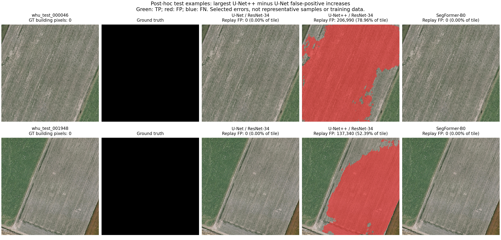

# Post-hoc background-error diagnosis

These are diagnostics of the already inspected WHU test, not a new performance endpoint or a trained fix. Primary test scores and original model/threshold selection remain unchanged.

| Model | IoU on 1,731 building-containing test tiles | FP pixels on 685 empty-label tiles | Empty-label tiles with any FP |
| --- | ---: | ---: | ---: |
| unet-resnet34 | 0.891150 | 82,495 | 38 |
| unetplusplus-resnet34 | 0.896218 | 977,484 | 48 |
| segformer-b0 | 0.882940 | 104,345 | 35 |

Subgroup counts sum to the unchanged full-test confusion counts. Building-containing subset IoU is diagnostic only; all 2,416 tiles remain in the primary test metric.

## Selected agricultural-looking examples

The two examples were selected post hoc by largest U-Net++ minus U-Net FP count, with sample ID breaking ties. This is an error illustration, not a random/representative sample or evidence of land-cover prevalence. Agricultural appearance is a visual interpretation, not a labelled land-cover category.

| Test ID | Annotated building pixels | U-Net FP pixels | U-Net++ FP pixels | U-Net++ fraction of tile |
| --- | ---: | ---: | ---: | ---: |
| whu_test_000046 | 0 | 0 | 206,990 | 78.96% |
| whu_test_001948 | 0 | 0 | 137,340 | 52.39% |



[SVG](field_examples.svg) | [Analysis JSON](analysis.json) | [Paired tile counts](per_tile_error_comparison.csv) | [Frozen post-hoc selection](selection.json) | [Replay provenance](replay.json) | [Checksums](checksums.json).

Every selected input was replayed in its original batch-of-four neighborhood, using the same frozen checkpoints, local CUDA device, float32/no autocast and threshold 0.50. All six model/example confusion-count results exactly matched the original test CSVs. Red marks false-positive building pixels; original annotations and weights were not edited.

## Decoded label coverage

| Split | Tiles | Empty-label tiles | Empty-label share |
| --- | ---: | ---: | ---: |
| train | 4,736 | 419 | 8.85% |
| val | 1,036 | 299 | 28.86% |
| test | 2,416 | 685 | 28.35% |

All 8,188 actual PNG masks were decoded to calculate these counts. Few completely empty training tiles may limit exposure to some negative contexts, but this is not proof of the cause. Most training pixels are already background; validation and test have almost the same empty-tile proportion. The content of difficult backgrounds still needs a training/validation-only audit.

## Proposed repair, not executed

Audit training/validation labels and field-texture coverage; mine hard background errors from TRAIN only; test one sampling intervention against a matched continued-training control. Preserve foreground exposure and require lower validation background FP area without unacceptable building-recall/IoU loss. Confirm promising changes across paired seeds and a new geographic holdout. Do not train on these test examples or choose a threshold on them.

The current all-error miner is infrastructure to build on, not an implemented background-only stratified sampler. Neither this packet nor the accompanying documentation retrains, tunes, relabels or deploys a model. See the main architecture report for the staged repair protocol.

## Reproduction

```powershell
python scripts/analyze_texture_errors.py --test-packet docs/results/whu_architecture_test_2026-11-16 --results <verified-batch16-results> --data data/whu_official_prepared --out <fresh-error-directory> --device cuda --examples 2
```

The generator produces the numeric/figure evidence. This README is the accompanying published explanation. Checksums cover the full published packet except the checksum manifest itself.
