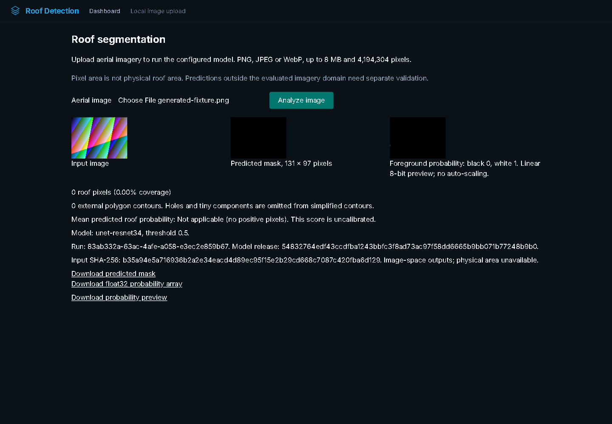
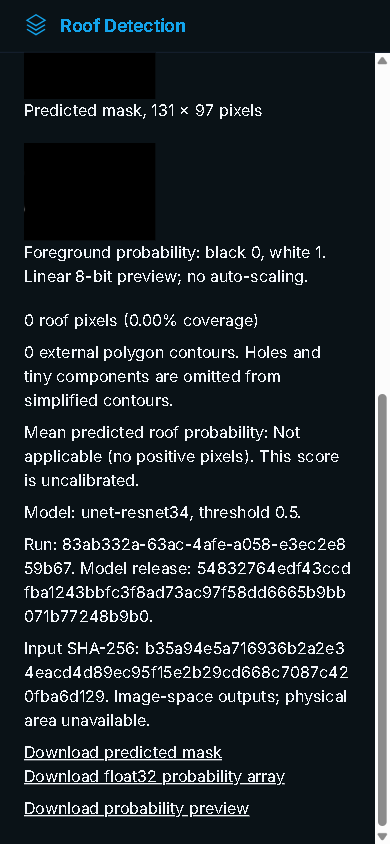

# Wave 2 real-model browser acceptance — November 1, 2026

The real registered U-Net checkpoint now has an executed browser journey through
the rebuilt original multistage image. This packet uses generated numerical RGB
input and actual model outputs; it is not an aerial-imagery accuracy measurement.
Historical WHU evidence and earlier explicitly unrun UI records remain unchanged.

## Observed acceptance

| Check | Result |
| --- | --- |
| Real-checkpoint browser acceptance | **1 passed**, zero assertion failures |
| Existing separate Tiny-checkpoint browser suite | **5 passed**; untrained integration fixtures only |
| Frontend regression units | **10 passed** |
| API/pipeline and probability-export regressions | **48 passed** |
| Chromium / Playwright | 145.0.7632.6 / 1.58.2, matching Chromium revision 1208 |
| Original image | `sha256:9208f26ecca92cadd36922875560efc2711183247bedfbd6c77e9055ba58a8b6` |
| Registered checkpoint | `2c5757995dafaa206abac4e22e384cdef78b4d93ab9026975050307ac2d9c7c5` |
| Desktop / half desktop / mobile | 1440 / 720 / 390 and 320 CSS-pixel widths inspected |
| Horizontal overflow | 0 at 720, 390 and 320 widths |
| Enabled Analyze text contrast | Observed ratio 4.895; targeted control check, not full conformance certification |
| Keyboard / reduced motion | Visible file-input focus, Enter-triggered actual analysis, preference reflected |
| Actual mask / float32 array / preview downloads | All match the displayed run's filenames and server artifact hashes |

The generated 131-by-97 input produces **zero foreground pixels**. The UI retains
that valid result, displays the real mask and probability preview, reports the
uncalibrated foreground statistic as not applicable, and withholds physical area.
Run, input and model-release identities are visible. The preview maps probability
0..1 linearly to 8-bit black..white without auto-scaling; exact float32 values
remain downloadable.





## Bugs found and fixed

- The native file control overflowed 320-pixel layouts by 59 pixels. Explicit
  minimum/maximum sizing now keeps the input and results within the viewport.
- A startup API failure banner remained after later successful real inference.
  Success clears that banner, and a late failed startup probe cannot restore it.
- Probability values were downloadable but had no visible raster. The service
  now exports a correctly labeled linear preview from its existing probabilities,
  with CLI/API hashes and a pixel-exact quantization regression test.
- Invalid or oversized input left a broken image icon. Failed preview decoding
  is cleared safely, and oversized input is not decoded for preview.
- Unimplemented account/notification controls were removed, alongside the
  unnecessary icon-font request; the retained brand uses a local inline SVG.

Invalid files and oversized uploads display errors without model masks or stale
downloads. Missing-backend behavior is tested by aborting browser API transport,
not by manufacturing a successful response. After restoring transport, the next
actual model response clears the stale startup error. Selecting a genuinely new
file clears old results; pending inference disables selection and repeat submit.
Successful model responses in this journey are never mocked.

The initial baseline caught the overflow, stale banner and missing preview. One
initial test incorrectly expected a native change event when selecting the exact
same file again; it was corrected to select a distinct filename. Baseline traces
remain private; they are not reported as passing acceptance. The final invalid,
oversize, focus, failure/recovery and representative layout screenshots were
visually inspected while the owned browser/server/container were kept alive.

## Evidence and resource scope

`browser-proof.json` contains the actual browser observations and artifact hashes.
The preserved output payloads match the displayed-run download links, actual
Playwright download checks and server artifact records. `image-source-identity.json`
binds the rebuilt image and tested dirty source snapshot. Raw traces, complete
data-URL snapshots, private host addresses and process-control state are excluded.

Windows Chromium reached native Docker through a Windows-loopback-only transparent
HTTP relay to its own private WSL interface. This is test transport, not a fake
backend or a public service. Fixed service-specific ports and the expected
checkpoint/profile guard prevented another local application's reuse. A persistent
owned WSL keeper prevented idle distro shutdown during UI testing. Only owned
browser, proxy and container processes were cleaned up afterward.

Native cgroup-v2 memory peak reached the configured **1 GiB** ceiling; there were
1,259 memory-max pressure events, zero OOM events/kills, and clean container exit.
This is a **cap-limited** observation, not an uncapped memory requirement or proof
of headroom. Two CPUs were configured. No 512 MiB run was made because Roof has
no existing 512 MiB hosting target. No new hosting plan or paid service was used.

## Publication audit

After fetching all refs/tags, Gitleaks 8.30.1 used the vendor-default config,
`--log-opts=--all`, full redaction, ignored inline allow comments, and an empty
ignore file: zero findings in the captured 16-commit / 405-blob history snapshot.
Raw JSON stays private. This is a specific scan result, not a universal security
guarantee. No model weights or WHU image/label archives were tracked.

Unused Google-derived imagery (`api/satellite_test.png` and `docs/dashboard.png`)
was removed from the current tree. Existing already-public history was retained
per coordination; no history rewrite or legal-rights claim is made. Labelme
example images exactly match generated smoke-fixture RGB inputs. New screenshots
contain only this app and generated input/model outputs. See `publication-audit.json`.

## Reproduce and release boundary

With the original image running against the explicit verified local weights and
release, use a localhost URL and the repo's matching Playwright installation:

```powershell
cd app
npx --no-install playwright install chromium
$env:ROOF_REAL_MODEL_BASE_URL = 'http://127.0.0.1:18542'
$env:ROOF_QA_RUN_ID = 'new-local-acceptance'
npx --no-install playwright test --config=playwright.real-model.config.ts
```

The real-model config rejects non-loopback targets and does not download weights
or create a provider account. `ROOF_QA_HOLD_PATH` optionally keeps its owned
browser alive for manual screenshot inspection until that local marker exists.
The regular `playwright.config.ts` separately starts actual Tiny-checkpoint
integration fixtures. Do not merge those denominators or claim model quality
from either browser suite.

Local browser acceptance is complete for the declared workflow. No new training,
full-dataset scoring, public deployment or cloud-plan change occurred. This packet
does not assert full WCAG conformance, arbitrary-image generalization or production
scale. Remote push/visibility coordination belongs to the parent release task.
