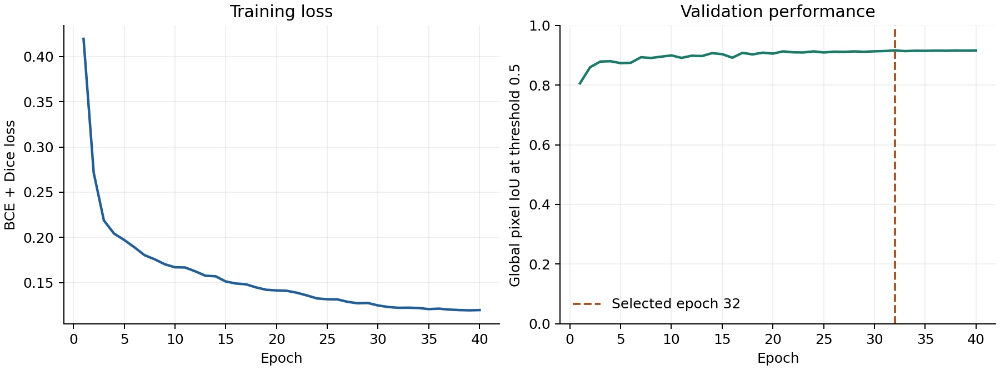

# Original WHU baseline evidence

Local RS-01 packet; not yet committed, published or deployed.

All 2,416 original per-image rows reproduce global pixel IoU 0.8921192509468081 and Dice 0.942984170263471. The validation-selected epoch was 32 of 40, with threshold 0.50. See `verification.json` for checks actually executed.

`source_manifest.json` identifies dirty training source based on commit `68f906e39d5bb259cb57532bdbaaa9769ec6c0b4`. This is not a claim that pristine public commit 4cf6fa1 was the training source. Every recorded source member was checked against the retained original source snapshot; that archive is not redistributed here.

`example_selection.json` preserves original sample IDs and selection policy. Qualitative panels, imagery and masks are omitted pending redistribution-rights review. The original sample policy did not register a separate empty-background group. Retrieve the official data and follow the baseline report to reproduce rendering; join sample IDs to `test_per_image.csv` and the prepared dataset manifest.

Reproduction and original result: [baseline report](../../docs/WHU_BASELINE_2026-10-28.md). No retraining is required to inspect these metrics. Original run and data remain unchanged.

Verify with `python scripts/export_portfolio_evidence.py --verify reports/whu-baseline-2026-10-28` from the repository root. `SHA256SUMS.txt` covers every other packet file.

- WHU binary building extent; no roof material, damage, instance or Minnesota validation.
- Original test used frozen validation threshold; later test reuse makes follow-up comparisons development work.
- Training source was dirty on its recorded base commit; per-file hashes identify the exact snapshot.
- Metrics were recomputed from original rows; inference and training were not rerun for this packet.
- Imagery redistribution rights are unconfirmed; no imagery, masks or qualitative image panels are included.
- Legacy address demo is not verified against this checkpoint.
